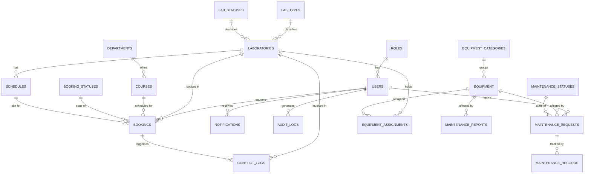

# LabTrack 
## Computer Laboratory Equipment and Schedule Tracker

### Group members
- Bermudo, Micha - SIA
- Rideout, Rainee Roh
- Tinio, Xian Xavier - DBMS
- Valencia, Atonia Marie
- Venerable, Jorgie Lou
- Vincoy, Christian Harvey

### Scope and planned features
1. User and Access Management
- Register or create user accounts, depending on the final authentication design.
- Sign in and sign out.
- Apply role-based permissions to restricted features.
- View relevant user records where permitted.
2. Laboratory Management
- Add, view, edit, and remove laboratory records when permitted.
- Store laboratory name, location, capacity, type, and status.
- Identify laboratories that are unavailable or under maintenance.
3. Booking and Schedule Management
- Create and view laboratory booking requests.
- Store the requested date, start time, end time, requester, and booking status.
- Review and update booking requests according to the agreed workflow.
- Check for overlapping bookings before accepting a reservation.
4. Equipment Inventory
- Record equipment name, category, identifier, condition, and status.
- Track equipment assignments to laboratories.
- Identify equipment that is unavailable, damaged, or under maintenance.
5. Maintenance Management
- Record maintenance requests and their reported problems.
- Track maintenance status and maintenance history.
- Link maintenance records to the affected equipment.
6. Reports and Dashboard
- Display useful summaries of laboratories, bookings, equipment, and maintenance.
- Use SQL joins to show related records in one report.
- Display detected schedule conflicts and unavailable resources.

### Major Feature:
Schedule conflict and equipment availability checker

- Database = MySQL
- Backend = Node.js
- Webframework = Express.js
- Frontend = HTML, CSS, JavaScript
- API = Rest API and JSON
//subject to change

### Member Responsibilities

Jorgie (Venerable)
- User and access management
- Tables: `users`, `roles`, `audit_logs`
- Accounts, permissions, and important activity history

Tonia (Valencia)
- Laboratory management
- Tables: `laboratories`, `lab_types`, `lab_statuses`
- Laboratory details and lookup values

Rain (Rideout)
- Booking and scheduling
- Tables: `bookings`, `schedules`, `booking_statuses`
- Booking requests, time slots, and booking states

Harvey (Vincoy)
- Equipment inventory
- Tables: `equipment`, `equipment_categories`, `equipment_assignments`
- Equipment details, categories, and laboratory assignments

Xian (Tinio)
- Maintenance management
- Tables: `maintenance_requests`, `maintenance_records`, `maintenance_statuses`, `maintenance_reports`
- Report issues, maintenance work, and status values

Micha (Bermudo)
- Conflict detection and reporting support
- Tables: `departments`, `courses`, `conflict_logs`, `notifications`
- Organizational/course details, conflict outcomes, and notifications

### Rules for Repository
- Keep main in a working state.
- Do not commit directly to main unless the instructor specifically directs the team to do so.
- Use feature branches and pull requests for changes.
- Make regular, meaningful commits that reflect your own work.
- Follow the instructor's required merge method and contribution-history rules.
- Do not share GitHub passwords or personal access tokens.
- Discuss schema and API changes with affected members before merging.
- Every member should be able to explain the code and design decisions they contributed.

### DO NOT FORGET!
- Pull or fetch the latest repository changes before starting work.
- Create a feature branch for a focused task.
- Make and test the changes locally.
- Commit meaningful work under the member's own GitHub account.
- Push the branch and open a pull request.
- Request a review from a teammate and address feedback.
- Merge the reviewed pull request into main using the merge method required by the sir.
- Update documentation when a feature, database field, route, or setup step changes.

### Setup Instructions
#### Prerequisite
- Node.js and npm
- MySQL Server
- MySQL Workbench (recommended)
- Git

1. Clone the repository
```
git clone https://github.com/Jjorgielou/LabTrack.git
cd LabTrack
```
2. Create the database
Open MySQL Workbench and execute the SQL script in:
```
`database/schema.sql`
```
maggama nig initial database tables for user and access management.
To insert the example roles and users, execute:
```
`database/sample-data.sql`
```
Only run the sample-data script kung ang sample records have not already been inserted.

3. Configure environment variables
Inside the `backend` folder, create a `.env` file containing your own local MySQL credentials:
```Text
DB_HOST=localhost
DB_PORT=3306
DB_USER=root
DB_PASSWORD=your_local_mysql_password
DB_NAME=labtrack_db
```

Use the variable names expected by `backend/config/db.js`. If the existing configuration uses different names, update this example to match it.

AYAW I COMMIT ANG  `.env` KAY NAA DIHA ANG PASSWORD NIMO SA DATABASE!

4. Install backend dependencies
From the project root, run:
```
cd backend
npm install
```
5. Start the backend
```
npm run dev
The server should start on `http://localhost:3000`, unless another port is configured.
```
6. Test the API
Open these endpoints in a browser:
```
- `http://localhost:3000/` — checks whether the backend is running.
- `http://localhost:3000/api/health/db` — checks the MySQL connection.
```
7. Verify the setup
After completing Steps 1–6, confirm everything works:

- [ ] `http://localhost:3000/` returns a JSON response confirming the server is running.
- [ ] `http://localhost:3000/api/health/db` returns a success message.
- [ ] Open `frontend/login.html` via Live Server at `http://127.0.0.1:5500` and sign in with a sample account from `sample-data.sql`.
- [ ] All six module pages load: Users, Laboratories, Bookings, Equipment, Maintenance, Conflicts.
- [ ] Trigger conflict detection: `POST /api/conflicts/check` — should return any overlapping bookings.
- [ ] Confirm role-based access: log in as a Student and verify that Add/Edit/Delete buttons are hidden on the Equipment page.

### Equipment Inventory Module

Load order for the database scripts:
1. Run the laboratory schema first, because equipment_assignments references laboratories(lab_id).
2. Then run `database/equipment_schema.sql`. It creates equipment_categories, equipment and equipment_assignments.

Extra .env variables (add these to the ones in step 3):
SESSION_SECRET=any_long_random_text
PORT=3000

### API endpoint list

All routes are prefixed with `/api`. Authenticated endpoints require a valid session token.

#### Authentication (`/api/auth`)
| Method | Route | Description | Owner |
| --- | --- | --- | --- |
| `POST` | `/api/auth/register` | Create a new user account | Jorgie |
| `POST` | `/api/auth/login` | Sign in, returns session token | Jorgie |
| `POST` | `/api/auth/logout` | End current session | Jorgie |
| `GET`  | `/api/auth/me` | Get current user profile | Jorgie |

#### Users (`/api/users`)
| Method | Route | Description | Owner |
| --- | --- | --- | --- |
| `GET`    | `/api/users` | List all users (admin/staff) | Jorgie |
| `GET`    | `/api/users/:id` | Get user by ID | Jorgie |
| `POST`   | `/api/users` | Create a new user | Jorgie |
| `PUT`    | `/api/users/:id` | Update user (name, role, email) | Jorgie |
| `DELETE` | `/api/users/:id` | Deactivate / delete a user | Jorgie |

#### Roles (`/api/roles`)
| Method | Route | Description | Owner |
| --- | --- | --- | --- |
| `GET` | `/api/roles` | List all roles | Jorgie |

#### Audit Logs (`/api/audit-logs`)
| Method | Route | Description | Owner |
| --- | --- | --- | --- |
| `GET` | `/api/audit-logs` | View system activity log | Jorgie |

#### Laboratories (`/api/laboratories`)
| Method | Route | Description | Owner |
| --- | --- | --- | --- |
| `GET`    | `/api/laboratories` | List all laboratories | Tonia |
| `GET`    | `/api/laboratories/:id` | Get lab details with type/status | Tonia |
| `POST`   | `/api/laboratories` | Create a new laboratory | Tonia |
| `PUT`    | `/api/laboratories/:id` | Update laboratory details | Tonia |
| `DELETE` | `/api/laboratories/:id` | Remove a laboratory | Tonia |

#### Lab Types & Statuses (Master Data)
| Method | Route | Description | Owner |
| --- | --- | --- | --- |
| `GET` | `/api/laboratories/types` | List lab types | Tonia |
| `GET` | `/api/laboratories/statuses` | List lab statuses | Tonia |

#### Bookings (`/api/bookings`)
| Method | Route | Description | Owner |
| --- | --- | --- | --- |
| `GET`    | `/api/bookings` | List all bookings (with lab/course details via JOIN) | Rain |
| `GET`    | `/api/bookings/:id` | Get booking detail | Rain |
| `POST`   | `/api/bookings` | Create a new booking request | Rain |
| `PUT`    | `/api/bookings/:id` | Update booking status / details | Rain |
| `DELETE` | `/api/bookings/:id` | Cancel / delete a booking | Rain |

#### Schedules (`/api/schedules`)
| Method | Route | Description | Owner |
| --- | --- | --- | --- |
| `GET`    | `/api/schedules` | List available time slots | Rain |
| `GET`    | `/api/schedules/:id` | Get schedule detail | Rain |
| `POST`   | `/api/schedules` | Create a new schedule slot | Rain |
| `PUT`    | `/api/schedules/:id` | Update schedule availability | Rain |
| `DELETE` | `/api/schedules/:id` | Remove a schedule slot | Rain |

#### Booking Statuses
| Method | Route | Description | Owner |
| --- | --- | --- | --- |
| `GET` | `/api/bookings/statuses` | List booking statuses | Rain |

#### Equipment (`/api/equipment`)
| Method | Route | Description | Owner |
| --- | --- | --- | --- |
| `GET`    | `/api/equipment` | List all equipment (with category, lab assignment via JOIN) | Harvey |
| `GET`    | `/api/equipment/coverage` | Coverage report: unassigned equipment and labs with no equipment (simulated FULL OUTER JOIN: LEFT JOIN UNION RIGHT JOIN) | Harvey |
| `GET`    | `/api/equipment/:id` | Get equipment detail | Harvey |
| `POST`   | `/api/equipment` | Add new equipment | Harvey |
| `PUT`    | `/api/equipment/:id` | Update equipment details / condition / status | Harvey |
| `DELETE` | `/api/equipment/:id` | Remove equipment | Harvey |

#### Equipment Categories (`/api/equipment-categories`)
| Method | Route | Description | Owner |
| --- | --- | --- | --- |
| `GET`    | `/api/equipment-categories` | List all categories | Harvey |
| `POST`   | `/api/equipment-categories` | Create a category | Harvey |
| `PUT`    | `/api/equipment-categories/:id` | Update category | Harvey |
| `DELETE` | `/api/equipment-categories/:id` | Remove category | Harvey |

#### Equipment Assignments
| Method | Route | Description | Owner |
| --- | --- | --- | --- |
| `GET`    | `/api/equipment/assignments` | List equipment-to-lab assignments | Harvey |
| `POST`   | `/api/equipment/assignments` | Assign equipment to a lab | Harvey |
| `DELETE` | `/api/equipment/assignments/:id` | Unassign equipment | Harvey |

#### Maintenance (`/api/maintenance`)
| Method | Route | Description | Owner |
| --- | --- | --- | --- |
| `GET`    | `/api/maintenance/requests` | List all maintenance requests | Xian |
| `POST`   | `/api/maintenance/requests` | Submit a maintenance request | Xian |
| `PUT`    | `/api/maintenance/requests/:id` | Update request status | Xian |
| `GET`    | `/api/maintenance/records` | View maintenance history | Xian |
| `POST`   | `/api/maintenance/records` | Log maintenance work performed | Xian |
| `GET`    | `/api/maintenance/reports` | List maintenance reports | Xian |
| `POST`   | `/api/maintenance/reports` | Submit a maintenance report | Xian |
| `GET`    | `/api/maintenance/statuses` | List maintenance statuses | Xian |

#### Conflicts (`/api/conflicts`)
| Method | Route | Description | Owner |
| --- | --- | --- | --- |
| `GET`    | `/api/conflicts` | List all conflict logs | Micha |
| `PUT`    | `/api/conflicts/:id` | Update conflict status (reviewed / resolved / dismissed) | Micha |
| `POST`   | `/api/conflicts/check` | Trigger conflict detection for bookings | Micha |

#### Departments & Courses
| Method | Route | Description | Owner |
| --- | --- | --- | --- |
| `GET`    | `/api/departments` | List all departments | Micha |
| `POST`   | `/api/departments` | Create a department | Micha |
| `GET`    | `/api/courses` | List all courses (with department via JOIN) | Micha |
| `POST`   | `/api/courses` | Create a course | Micha |

#### Notifications (`/api/notifications`)
| Method | Route | Description | Owner |
| --- | --- | --- | --- |
| `GET` | `/api/notifications` | List user notifications | Micha |
| `PUT` | `/api/notifications/:id/read` | Mark notification as read | Micha |

#### Dashboard (`/api/dashboard`)
| Method | Route | Description | Owner |
| --- | --- | --- | --- |
| `GET` | `/api/dashboard` | Get summary stats (labs, bookings, equipment, maintenance counts) | Jorgie |

### API routes (all require login):
- GET /api/equipment - list all equipment
- GET /api/equipment/unavailable - equipment that is unavailable, under maintenance or damaged
- GET /api/equipment/coverage - coverage report: unassigned equipment and labs with no equipment (simulated FULL OUTER JOIN using LEFT JOIN UNION RIGHT JOIN)
- GET /api/equipment/:id - one equipment item
- POST /api/equipment - add equipment (Admin, Laboratory Staff)
- PUT /api/equipment/:id - edit equipment (Admin, Laboratory Staff)
- DELETE /api/equipment/:id - delete equipment (Admin, Laboratory Staff)
- GET /api/equipment-categories and GET /api/equipment-categories/:id - read categories
- POST /api/equipment-categories - add a category (Admin, Laboratory Staff)
- PUT /api/equipment-categories/:id - edit a category (Admin, Laboratory Staff)
- DELETE /api/equipment-categories/:id - delete a category (Admin, Laboratory Staff)

### Equipment page:
Open `frontend/login.html` with VS Code Live Server at http://127.0.0.1:5500 (the backend only allows this address), sign in, then click Equipment. Students can view equipment but cannot add, edit or delete.

### Reports and Join Queries

Each member owns one join report exposed through a GET endpoint and rendered on a frontend screen.

| Report Name | Owner | Endpoint | Frontend Screen | Join Type | Tables Joined |
| --- | --- | --- | --- | --- | --- |
| User Activity Report | Jorgie | `GET /api/audit-logs` | `users.html` | LEFT JOIN | `audit_logs` LEFT JOIN `users` LEFT JOIN `roles` |
| Laboratory Details Report | Tonia | `GET /api/laboratories` | `laboratories.html` | INNER JOIN | `laboratories` INNER JOIN `lab_types` INNER JOIN `lab_statuses` |
| Booking Schedule Report | Rain | `GET /api/bookings` | `bookings.html` | INNER JOIN | `bookings` INNER JOIN `booking_statuses` INNER JOIN `laboratories` INNER JOIN `schedules` |
| Equipment Inventory Report | Harvey | `GET /api/equipment` | `equipment.html` | LEFT JOIN | `equipment` LEFT JOIN `equipment_categories` LEFT JOIN `equipment_assignments` LEFT JOIN `laboratories` |
| Equipment Coverage Report | Harvey | `GET /api/equipment/coverage` | none yet (API only) | Simulated FULL OUTER JOIN (LEFT JOIN UNION RIGHT JOIN) | `equipment` LEFT JOIN `equipment_assignments` LEFT JOIN `laboratories` UNION `equipment` RIGHT JOIN `equipment_assignments` RIGHT JOIN `laboratories` |
| Maintenance History Report | Xian | `GET /api/maintenance/records` | `maintenance.html` | LEFT JOIN | `maintenance_records` LEFT JOIN `maintenance_requests` LEFT JOIN `equipment` LEFT JOIN `maintenance_statuses` |
| Conflict & Notification Report | Micha | `GET /api/conflicts` | `conflicts.html` | LEFT JOIN | `conflict_logs` LEFT JOIN `bookings` LEFT JOIN `laboratories` LEFT JOIN `notifications` |


### ER Diagram




### Ownership matrix

| Member | GitHub Username | Tables | Endpoints/Screens | Join Report & Join Type | Feature Role |
| --- | --- | --- | --- | --- | --- |
| Venerable, Jorgie Lou | @Jjorgielou | `roles` `users` `audit_logs` | `login.html` | **LEFT JOIN** | User & Access Management |
| Valencia, Antonia Marie | @BebeFumi | `lab_types` `lab_statuses` `laboratories` | `laboratories.html` | **INNER JOIN** | Master Data & Laboratories |
| Rideout, Rainee Roh | @sharkbait001 | `booking_statuses` `schedules` `bookings` | `bookings.html` | **INNER JOIN** | Booking & Scheduling |
| Vincoy, Christian Harvey | @harvyyyyy | `equipment_categories` `equipment` `equipment_assignments` | `equipment.html` | **LEFT JOIN** | Equipment Inventory |
| Tinio, Xian Xavier | @xaviertinio2007-debug | `maintenance_statuses` `maintenance_reports` `maintenance_requests` `maintenance_records` | `maintenance.html` | **LEFT JOIN** | Maintenance |
| Bermudo, Micha | @MichaBermudo | `departments` `courses` `conflict_logs` `notifications` | `conflicts.html` | **LEFT JOIN** | Conflict Detection & Reporting |


### Project structure
```Text
LabTrack/
├── backend/
│   ├── config/
│   │   └── db.js                             # Database connection setup
│   ├── controllers/                          # Database queries and logic
│   │   ├── auditLogController.js
│   │   ├── authController.js
│   │   ├── bookingController.js
│   │   ├── conflictController.js
│   │   ├── courseController.js
│   │   ├── dashboardController.js
│   │   ├── departmentController.js
│   │   ├── equipmentCategoryController.js
│   │   ├── equipmentController.js
│   │   ├── laboratoryController.js
│   │   ├── maintenanceController.js
│   │   ├── scheduleController.js
│   │   └── userController.js
│   ├── middleware/                           # Auth and validation
│   │   ├── requireAuth.js
│   │   └── requireRole.js
│   ├── models/                               # Business logic and validation
│   │   ├── auditLogModel.js
│   │   ├── bookingModel.js
│   │   ├── ConflictModels.js
│   │   ├── courseModel.js
│   │   ├── departmentModel.js
│   │   ├── equipmentCategoryModel.js
│   │   ├── equipmentModel.js
│   │   ├── laboratoryModel.js
│   │   ├── maintenanceModel.js
│   │   ├── scheduleModel.js
│   │   └── userModel.js
│   ├── routes/                               # Endpoint route definitions
│   │   ├── auditLogs.js
│   │   ├── auth.js
│   │   ├── bookingRoutes.js
│   │   ├── conflictRoutes.js
│   │   ├── courseRoutes.js
│   │   ├── departmentRoutes.js
│   │   ├── equipment.js
│   │   ├── equipmentCategories.js
│   │   ├── laboratories.js
│   │   ├── maintenanceroutes.js
│   │   ├── scheduleRoutes.js
│   │   └── users.js
│   ├── utils/                                # Helper functions
│   │   └── response.js
│   ├── app.js                                # App entry point
│   ├── package.json                          # Backend dependencies
│   ├── package-lock.json                     # Backend dependency lock file
│   └── server.js                             # Server listener
├── database/                                 # Database scripts
│   ├── additional_tables.sql
│   ├── equipment_schema.sql
│   ├── sample-data.sql
│   └── schema.sql
├── frontend/                                 # Client application
│   ├── css/                                  # Stylesheets
│   │   ├── equipment.css
│   │   └── style.css
│   ├── js/                                   # Client-side scripts
│   │   ├── api.js
│   │   ├── auditLogs.js
│   │   ├── auth.js
│   │   ├── booking.js
│   │   ├── conflicts.js
│   │   ├── dashboard.js
│   │   ├── equipment.js
│   │   ├── notifications.js
│   │   ├── users.js
│   │   ├── app.js
│   │   ├── config-dashboard.js
│   │   └── maintenance.js
│   ├── index.html                            # Main dashboard
│   ├── login.html                            # Login screen
│   ├── register.html                         # Registration
│   ├── laboratories.html                     # Laboratory management
│   ├── bookings.html                         # Booking management
│   ├── equipment.html                        # Equipment inventory
│   ├── maintenance.html                      # Maintenance tracking
│   ├── conflicts.html                        # Conflict detection
│   ├── notifications.html                    # Notifications
│   ├── reporting.html                        # Reports
│   ├── reports.html                          # Report views
│   └── users.html                            # User management
├── .gitignore                                # node_modules, .env, .vscode
└── README.md                                 # Roster, Ownership Matrix, Setup instructions
```
